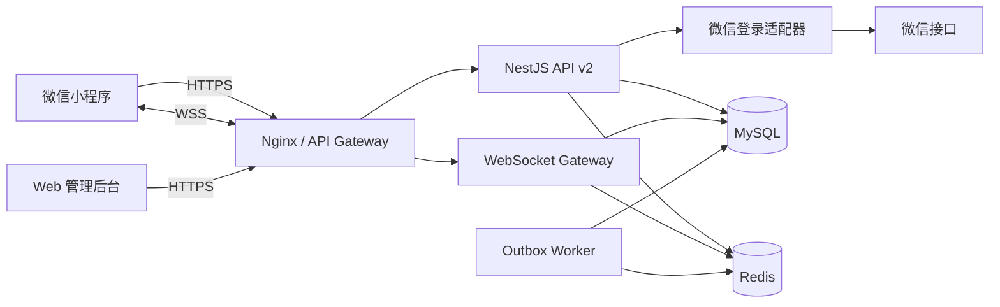
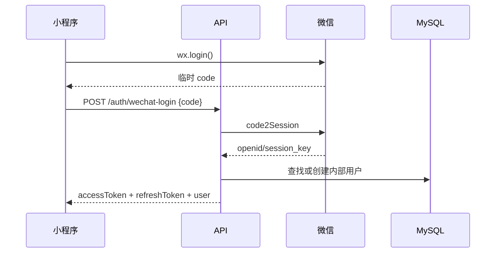
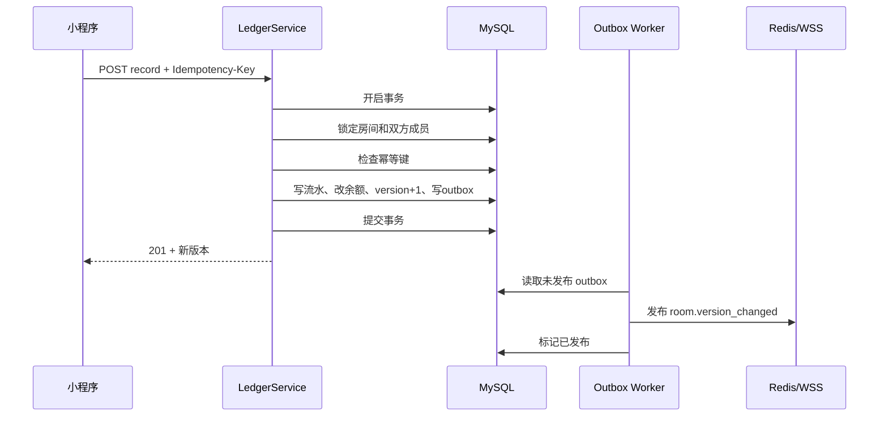

# 技术架构方案

## 1. 逻辑架构



## 2. 仓库建议

推荐独立仓库：

```text
play-ledger/
├── apps/
│   ├── miniprogram/       uni-app Vue 3
│   ├── api/               NestJS
│   └── admin/             可选，迁入现有管理后台
├── packages/
│   ├── contracts/         DTO、事件和错误码类型
│   └── eslint-config/
├── deploy/
├── docs/
└── package.json
```

如果希望先低风险推进，可以第一阶段只新建小程序仓库，后端仍在当前仓库开发 `/api/v2`；正式上线后再拆后端仓库。

## 3. 小程序端模块

```text
src/
├── pages/
├── components/
├── stores/
│   ├── auth.ts
│   └── room.ts
├── services/
│   ├── request.ts
│   ├── auth.ts
│   ├── rooms.ts
│   └── socket.ts
├── composables/
│   ├── useAuth.ts
│   ├── useRoom.ts
│   └── useNetwork.ts
├── contracts/
├── utils/
├── pages.json
└── manifest.json
```

请求层职责：

- 自动添加 `Authorization`、`X-Request-Id`。
- 401 时串行刷新 token，最多重放一次原请求。
- 写接口携带 `Idempotency-Key`。
- 统一把服务端错误码映射为用户文案。
- token 刷新失败时清理本地认证状态并重新登录。

## 4. 服务端模块

```text
src/
├── auth/
├── users/
├── rooms/
├── members/
├── ledger/
├── realtime/
├── share/
├── admin/
├── audit/
├── outbox/
└── common/
    ├── guards/
    ├── interceptors/
    ├── filters/
    └── idempotency/
```

禁止 controller 直接拼业务数据。controller 负责 DTO 和状态码，service 负责业务，repository 负责持久化。

## 5. 认证设计



- access token：JWT，建议 30 分钟。
- refresh token：随机不可预测字符串，建议 30 天；数据库仅存哈希。
- refresh token 轮换：每次刷新作废旧 token。
- WebSocket 使用 60 秒有效的单次连接票据，避免长期 JWT 出现在 URL 日志。
- `AppSecret`、session key、OpenID 不返回小程序业务页面。

## 6. 权限模型

每个房间写操作依次校验：

1. token 是否有效。
2. 用户状态是否有效。
3. 房间是否存在。
4. 用户是否为有效成员。
5. 房间是否可写。
6. 操作是否需要房主角色。
7. 目标成员是否有效。
8. 幂等键是否已经处理。

服务端从 token 推导 `operatorUserId`，从成员关系推导 `fromMemberId`，不得接受客户端伪造这些字段。

## 7. 事务记账



使用 Outbox 后，即使数据库提交后 Redis 短暂失败，事件仍可补发。

## 8. WebSocket 协议

### 建连

```text
POST /api/v2/realtime/ticket
GET  wss://api.example.com/ws?ticket=<one-time-ticket>
```

### 客户端消息

```json
{"type":"room.subscribe","requestId":"uuid","roomCode":"123456","lastVersion":82}
```

```json
{"type":"ping","ts":1730000000000}
```

### 服务端消息

```json
{
  "type": "room.version_changed",
  "eventId": "evt_123",
  "roomCode": "123456",
  "version": 83,
  "reason": "record.created",
  "occurredAt": "2026-09-12T12:00:00.000Z"
}
```

客户端规则：

- `version == localVersion + 1`：刷新房间摘要或增量接口。
- `version > localVersion + 1`：立即拉取完整快照。
- `version <= localVersion`：忽略重复或乱序事件。
- `onShow`、网络恢复和重连成功后始终拉一次快照。
- 连接失败超过 30 秒，启用 10 秒 REST 轮询；WSS 恢复后停止轮询。

## 9. 缓存设计

Redis key 建议：

```text
auth:refresh:<tokenId>             refresh token 元信息
ws:ticket:<ticket>                 单次连接票据，TTL 60s
room:online:<roomId>               在线用户集合，TTL 滚动刷新
room:channel:<roomId>              Pub/Sub 频道
rate:login:<ip>                    登录限流
rate:join:<userId>                 加入限流
share:scene:<scene>                分享场景映射
wx:access_token                    微信接口 token 缓存
```

余额、房间状态和流水不能只存在 Redis。

## 10. 安全基线

- HTTPS/WSS only，TLS 1.2 以上。
- CORS 限定管理后台域名；小程序请求不依赖浏览器 CORS。
- DTO 白名单验证，拒绝未知字段。
- 登录、查询房间、加入、记账分别限流。
- 房间号随机生成；分享使用额外邀请 token。
- 日志隐藏 token、code、OpenID、session key 和备注正文。
- 管理员强制独立认证，可选 TOTP；所有管理员查询和操作写审计日志。
- 禁止生产环境 `synchronize: true`，数据库只通过 migration 变更。
- 密钥由环境变量或密钥管理服务注入，不写入镜像和仓库。

## 11. 可观测性

日志统一字段：

```text
timestamp, level, requestId, userId, roomId, route,
statusCode, durationMs, errorCode, appVersion
```

核心指标：

- 登录、创建、加入、记账成功率。
- API P50/P95/P99。
- WebSocket 当前连接、重连和异常关闭数。
- 数据库事务冲突与死锁数。
- Outbox 待发布数量和最老消息年龄。
- 房间余额不平数量。
- 微信接口失败率和 access token 刷新失败率。

告警建议：

- 5 分钟写接口错误率超过 2%。
- P95 超过 1 秒持续 10 分钟。
- Outbox 最老消息超过 60 秒。
- 任意房间余额不平。
- MySQL/Redis 不可用或备份失败。

